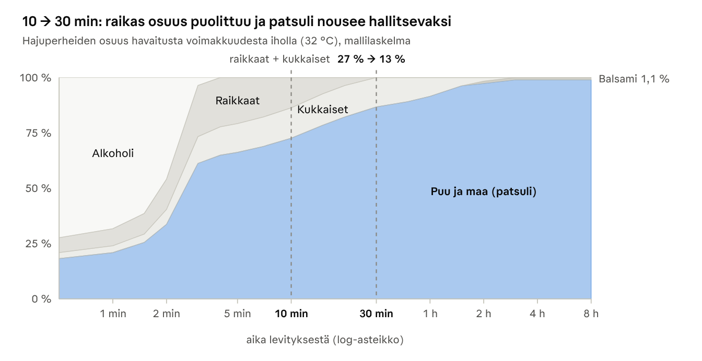
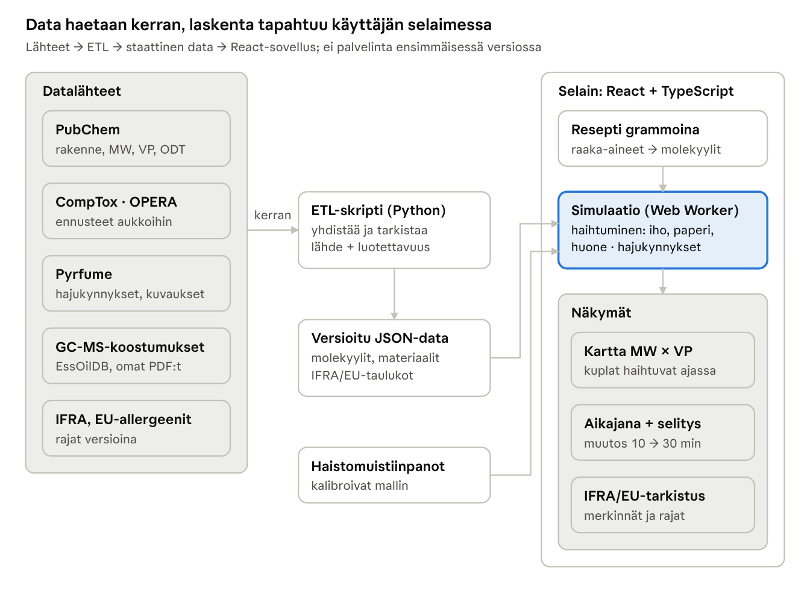

# Hajuvesityökalu – taustatutkimus ja algoritmiehdotus

20.11.2026

## Tiivistelmä

Suositus: rakennetaan oma, versioitu molekyylitietokanta avoimista lähteistä (PubChem, EPA CompTox/OPERA, Pyrfume) ja ajetaan haihtumis- ja hajumalli suoraan selaimessa React-sovelluksessa. Mikään yksittäinen API ei kata kaikkea: höyrynpaine, kynnysarvot, hajukuvaukset ja luonnonmateriaalien koostumukset tulevat eri paikoista.

Algoritmi on kaksiosainen. Ensin lasketaan, kuinka nopeasti kukin molekyyli haihtuu seoksesta (Raoultin laki, lämpötila, molekyylipaino). Sitten lasketaan, mitä nenä siitä havaitsee (odor value = pitoisuus ilmassa / hajukynnys, Stevensin laki).

Prototyyppi toimi oikeansuuntaisesti: iholla (32 °C) limoneenista oli haihtunut 90 % 14 minuutissa ja linaloolista 65 minuutissa, paperilla (22 °C) noin kaksi kertaa hitaammin.

- **Suurin epävarmuus on hajukynnyksissä**, ei haihtumisessa. Saman molekyylin kynnysarvot vaihtelevat lähteestä riippuen jopa satakertaisesti, joten kartan pitää näyttää vaihteluväli.
- **Kartta**: MW × höyrynpaine -kuplakartta, johon lisätään aikaliukusäädin. Kuplat kutistuvat sitä mukaa kuin molekyylit haihtuvat, ja sivupaneeli kertoo, mitä haistetaan juuri nyt ja mikä muuttui esim. 10 ja 30 minuutin välillä.
- **Tekniikka**: React + TypeScript (Vite), simulaatio Web Workerissa, data staattisena JSONina. Ei vaadi palvelinta ensimmäisessä versiossa.

## Mitä työkalun pitää tehdä

Työkalu näyttää molekyylitasolla, mitä tuoksussa tapahtuu ajan funktiona ja miksi. Mitoittava käyttötapaus: käyttäjä haistaa seosta iholta tai paperilta 1, 10, 30 ja 60 minuutin jälkeen, ei pidä 30 minuutin kohdasta ja katsoo kartasta, mitkä molekyylit siinä kohtaa katosivat ja mitkä nousivat esiin.

Vaatimukset transkriptista ja avainsanoista:

- **Resepti grammoina.** Raaka-aineet (eteeriset öljyt, absoluutit, CO2-uutteet, resinoidit, synteetit) puretaan molekyyleiksi, ja määrät suhteutetaan hajukynnyksiin.
- **Luonnonmateriaalit GC-MS-raporttien kautta.** Yhdessä öljyssä voi olla kymmeniä yhdisteitä.
- **Fysikaaliset suureet:** höyrynpaine (mmHg, yleensä ilmoitettu 25 °C:ssa), molekyylipaino (g/mol), hajukynnys (havaitseminen, tunnistaminen ja erotuskynnys).
- **Kolme tilaa:** iho, paperi (blotteri) ja huoneilma. Transkriptissa mainitaan iho ja huoneilma; paperi lisätään, koska sitä käytetään testauksessa.
- **Kemialliset ryhmät:** terpeenit, alkoholit, esterit, aldehydit, seskviterpeenit jne. näkyviin, koska rakenne selittää haihtuvuutta.
- **Formulointi + sääntely:** IFRA-rajat ja EU-allergeenit lasketaan valmiista seoksesta.
- **Vaikeat ilmiöt:** fiksatiivien hidastava vaikutus mallinnetaan, reaktiot (esim. Schiffin emäkset) näytetään varoituksina.
- **Haistomuistiinpanot:** käyttäjä merkitsee omat haistohetkensä ja havaintonsa aikajanalle. Niillä myös kalibroidaan malli.

## Datalähteet molekyyleille

Perusta on PubChem (rakenne, MW, kokeelliset höyrynpaineet) täydennettynä EPA:n OPERA-ennusteilla ja Pyrfumen hajuaineistoilla. Data haetaan kerran ETL-skriptillä omaan tietokantaan, eikä sovellus kutsu ulkoisia API:ja käyttäjän selaimesta.

| Lähde | Mitä saadaan | Pääsy | Huomio |
| --- | --- | --- | --- |
| [PubChem PUG REST + PUG View](https://pubchem.ncbi.nlm.nih.gov/docs/pug-view) | SMILES, MW, XLogP; kokeellinen höyrynpaine, hajukuvaus ja hajukynnys HSDB-osiosta | Ilmainen REST, ei avainta | Kattavin pohja. Esim. linalooli 0,16 mmHg ja hajukynnys n. 1 ppm. |
| [EPA CompTox CTX API](https://www.epa.gov/comptox-tools/computational-toxicology-and-exposure-apis) + [OPERA](https://github.com/NIEHS/OPERA) | Ennustettu höyrynpaine, logP, vesiliukoisuus, kun koearvo puuttuu | API-avain ilmaiseksi sähköpostilla; OPERA avoin lähdekoodi | Merkitään aina ”ennuste”. |
| [Pyrfume](https://zenodo.org/records/13820408) | Abraham 2012 -hajukynnykset (n. 270 molekyyliä, ppm), Leffingwell (3 523) ja Good Scents (4 565) hajukuvaukset, Arctander | GitHub, Python-kirjasto | Koodi MIT, mutta Leffingwellin ja Good Scentsin datalla on omat käyttörajoitukset. |
| The Good Scents Company (Pyrfumen kautta) | Pysyvyys blotterilla tunteina (1 305 ainetta), hajuvoimakkuus | Ei API:a, käyttöehtorajoitukset | Hyvä mallin tarkistamiseen, ei julkaistavaksi sellaisenaan. |
| [NIST: retentioindeksit](https://nist.gov/document-2072) + NIST WebBook | Retentioindeksit 505 eteerisen öljyn komponentille, Antoine-parametreja | Verkkosivut, ei virallista API:a | RI:stä voi arvioida höyrynpaineen, kun muuta ei ole. |
| [OpenPOM](https://github.com/BioMachineLearning/openpom) | Hajukuvausennuste rakenteesta, 138 deskriptoria | pip, avoin | Uusille molekyyleille, joilla ei ole kuvausta. |
| [Park 2012](https://escholarship.org/content/qt6c18p70s/qt6c18p70s.pdf) | Mitatut hajukynnykset 14 hajusteaineelle (0,44 ppt–4,1 ppb) ja tunnistuskynnysten suhde | Avoin opinnäyte | Ainoa löydetty avoin tunnistus/havaitsemis-suhde. |

**Varoitus yleisistä termodynamiikkakirjastoista.** Pythonin `thermo`-kirjasto antoi linaloolille 1,27 mmHg (PubChem 0,16), bentsyylibentsoaatille 0,0037 mmHg (PubChem 0,000224) ja vanilliinille 0,0032 mmHg (PubChem 0,000118). Virhe on 8–27-kertainen ja aina samaan suuntaan, joten näitä kirjastoja ei käytetä tuoksumolekyyleille.

**Jokainen arvo tallennetaan lähteineen.** Kenttinä arvo, yksikkö, lämpötila, lähde, menetelmä (koe / ennuste / arvio) ja luotettavuus. Ristiriidat ovat yleisiä: linalyyliasetaatille PubChem antaa 0,111 mmHg (25 °C) ja ICSC 0,6 Pa (20 °C), eli eroa on kymmeniä kertoja.

Lähteiden etusijajärjestys: vertaisarvioitu koearvo (HSDB, Yaws, Daubert) → OPERA-ennuste → RI-arvio → käyttäjän syöttämä arvo.

### Maksulliset vaihtoehdot

Pakollista maksullista API:a ei ole. Ainoa harkittava hankinta on hajukynnysten kokoelma, koska ilmaisia arvoja on vain osalle molekyyleistä:

- van Gemert: *Odour thresholds – compilations of odour threshold values in air, water and other media* (Oliemans Punter & Partners), lähes 18 000 arvoa noin 3 000 lähteestä.
- Devos ym.: *Standardized Human Olfactory Thresholds*, standardoidut kynnykset 529 yhdisteelle.

Molemmat ovat kirjoja ilman rajapintaa, ja arvojen julkaisuoikeus työkalussa pitää tarkistaa erikseen. Tutkimusten välinen vaihtelu on silti kertaluokkia, joten vaihteluvälin näyttäminen ja kalibrointi ovat joka tapauksessa tarpeen.

## Luonnonmateriaalien koostumus (GC-MS)

Tarkin lähde on käyttäjän oman toimittajan eräkohtainen GC-MS-raportti. Oletuskirjasto täytetään kirjallisuudesta, jotta työkalu toimii heti ilman omia raportteja.

- **Tuonti PDF:stä.** Käyttäjä lataa raportin, sovellus poimii taulukon (yhdiste, CAS, %, retentioindeksi) ja pyytää vahvistamaan tunnistukset ennen tallennusta.
- **Oletuskirjasto.** [EssOilDB](https://pmc.ncbi.nlm.nih.gov/articles/PMC4273207) on ilmainen tietokanta, jossa on 123 041 julkaistua eteerisen öljyn koostumustietuetta. Lisäksi ISO-standardien vaihteluvälit ja tutkimusartikkelit.
- **Vaihteluväli, ei yksi luku.** Kemotyyppi, alkuperä ja vuosikerta muuttavat koostumusta. Tallennetaan min–max ja simuloidaan molemmat ääripäät.
- **Pinta-ala-% ≠ massa-%.** GC-MS:n prosentit ovat yleensä piikkien pinta-aloja. Ero on pieni samankaltaisille terpeeneille, mutta käyttöliittymä kertoo, kumpaa luku tarkoittaa.
- **Haihtumaton osa puuttuu raportista.** Resinoideissa, absoluuteissa ja CO2-uutteissa on vahoja ja hartseja, jotka eivät näy GC:ssä. Ne lisätään ”haihtumaton jäännös” -komponenttina, koska juuri se hidastaa muiden haihtumista.

**GC-MS-järjestys kertoo haihtuvuudesta, mutta ei kaikkea.** Ei-polaarisessa kolonnissa yhdisteet tulevat ulos suunnilleen kiehumispisteen mukaan, mikä seuraa haihtumisjärjestystä iholla. [Hoskovec ym. 2005](https://pherobase.com/literature/data/details/E/12192) osoittivat, että pelkällä retentioindeksillä höyrynpaineen vaihtelusta selittyy noin 89 %, ja rakenteen korjaustermillä yli 99 %. Siksi RI:tä käytetään varamenetelmänä, kun mitattua höyrynpainetta ei ole.

## Algoritmi, osa 1: haihtumismalli

Jokaisen molekyylin haihtumisnopeus riippuu sen höyrynpaineesta, sen osuudesta jäljellä olevassa seoksessa ja lämpötilasta. Tämä on perfume engineering -tutkimuksen vakiintunut lähestymistapa ([Rodrigues ym. 2021](https://mdpi.com/1420-3049/26/11/3095)), ja se ratkaistaan tavallisena differentiaaliyhtälöryhmänä.

```math
\frac{dn_i}{dt} = -\,k_{g,i}\,\gamma_i\,x_i\,\frac{P_i^{sat}(T)}{R\,T} \;-\; k_{abs,i}\,n_i, \qquad x_i = \frac{n_i}{\sum_j n_j}
```

- nᵢ = molekyylin ainemäärä pinnalla (mol/m²), xᵢ = mooliosuus jäljellä olevassa nesteessä (Raoultin laki).
- γᵢ = aktiivisuuskerroin: 1 ensimmäisessä versiossa, myöhemmin UNIFAC-ryhmäosuusmenetelmällä.
- k_abs = imeytyminen ihoon, vain ihotilassa.

Höyrynpaine siirretään 25 °C:sta todelliseen lämpötilaan Clausius–Clapeyronin yhtälöllä:

```math
P_i^{sat}(T) = P_i^{sat}(298{,}15\,\mathrm{K})\,\exp\!\left[-\frac{\Delta H_{vap,i}}{R}\left(\frac{1}{T}-\frac{1}{298{,}15\,\mathrm{K}}\right)\right]
```

Iho on noin 30–32 °C ([Kasting](https://stacks.cdc.gov/view/cdc/191994/cdc_191994_DS1.pdf)) ja paperi huoneenlämmössä. Kun höyrystymislämpö on 60 kJ/mol, 22 °C → 32 °C kasvattaa höyrynpainetta noin 2,2-kertaiseksi. Tämä selittää, miksi sama seos kehittyy iholla selvästi nopeammin kuin paperilla.

**Molekyylipaino ja ”lift”.** Havainnolle on fysikaalinen pohja: kevyen molekyylin diffuusiokerroin ilmassa on suurempi (karkeasti D ∝ MW⁻⁰˙⁵), joten se kulkee ilmassa nopeammin ja kauemmas. Mallissa tämä näkyy aineensiirtokertoimessa k_g ∝ D^(2/3). Höyrynpaine on silti päätekijä, ja rakenne ratkaisee sen:

| Molekyyli | MW (g/mol) | Höyrynpaine 25 °C (mmHg) | Miksi |
| --- | --- | --- | --- |
| Linalooli | 154 | 0,16 | OH-ryhmä muodostaa vetysidoksia |
| Linalyyliasetaatti | 196 | 0,111 | Raskaampi, mutta esteri ei muodosta vetysidoksia |
| Vanilliini | 152 | 0,000118 | Kevyt, mutta fenoli + aldehydi sitovat voimakkaasti |
| Bentsyylibentsoaatti | 212 | 0,000224 | Suuri aromaattinen esteri |

Arvot: PubChem/HSDB. Siksi kemiallinen ryhmä (alkoholi, esteri, terpeeni, seskviterpeeni) näytetään kartalla omana värinään.

**Kolme tilaa samalla moottorilla:**

1. **Iho:** 32 °C ja imeytyminen. Kastingin ja Saiyasombatin malli jakaa molekyylin haihtuvaan ja imeytyvään osaan höyrynpaineen, MW:n ja rasvaliukoisuuden (K_oct · S_w) perusteella; tarkkuus on kertoimen kaksi sisällä. Haihtuvat ylänuotit enimmäkseen haihtuvat, raskaammista suurempi osa imeytyy.
2. **Paperi:** huonelämpötila, ei imeytymistä.
3. **Huoneilma:** sama haihtumislähde + huoneen tasemalli dC/dt = J·A/V − ilmanvaihto·C. Tuoksujälki etäisyyden funktiona Fickin diffuusiomallilla (Teixeira ym.).

**Kalibroitavat parametrit.** Aineensiirtokerroin k_ref (tyyni ilma, prototyypissä 0,001 m/s) ja nenään päätyvä laimennus φ sovitetaan kirjallisuuden headspace-mittauksiin ja käyttäjien haistomuistiinpanoihin. Yhtälöryhmä on jäykkä (etanoli haihtuu minuuteissa, patsulioli päiviä). Selainversio ratkaisee sen eksponentiaalisella keskipistemenetelmällä: koska xᵢ = nᵢ/N, yhtälö on lineaarinen nᵢ:n suhteen ja ratkeaa stabiilisti.

## Algoritmi, osa 2: mitä nenä havaitsee

Haihtumismalli kertoo, paljonko kutakin molekyyliä on ilmassa. Havaintomalli muuttaa sen hajuksi: molekyyli kuuluu vasta, kun sen pitoisuus ylittää hajukynnyksen, ja voimakkuus kasvaa hitaammin kuin pitoisuus.

```math
OV_i = \frac{c_i}{ODT_i}, \qquad \psi_i = k\,OV_i^{\,n_i} \;\; (OV_i > 1), \qquad \text{osuus}_i = \frac{\psi_i}{\sum_j \psi_j}
```

- **Odor value (OV)** = pitoisuus ilmassa jaettuna hajukynnyksellä ([Rodrigues ym. 2021](https://mdpi.com/1420-3049/26/11/3095)). OV > 1 tarkoittaa, että molekyyli havaitaan.
- **Stevensin laki** ψ = k·OVⁿ: eksponentti on hajuilla aina alle 1, mitatut arvot 0,13 (oktanoli) – 0,72 (eugenoli) ([Berglund ym.](https://typeset.io/pdf/individual-psychophysical-functions-for-28-odorants-2te6nrlrlq.pdf)). Oletus 0,5, jos molekyylille ei ole omaa arvoa.
- **Seos:** Strongest Component Model – vahvin komponentti määrää hajun luonteen. Kartalla näytetään jokaisen molekyylin ja hajuperheen osuus kokonaisvoimakkuudesta (Perfumery Radar).

**Kolme kynnystä, kuten avainsanoissa:**

| Kynnys | Määritelmä | Arvo työkalussa |
| --- | --- | --- |
| Havaitsemiskynnys (absolute) | Pienin pitoisuus, jonka nenä erottaa tyhjästä | Molekyylikohtainen ODT tietokannasta |
| Tunnistuskynnys | Pienin pitoisuus, jolla haju osataan nimetä | Yleensä 2–4 × ODT, poikkeuksia 12–21 × ([Park 2012](https://escholarship.org/content/qt6c18p70s/qt6c18p70s.pdf)); oletus 3 × |
| Erotuskynnys (difference) | Pienin huomattava voimakkuuden muutos | Weberin suhde n. 0,28 ([Stone 1965](https://scilit.com/publications/b267c4c40bdc7abcd867ed8bb89c0767)); muutos alle n. 30 % ei erotu |

**”Miksi 30 minuutin kohdalla muuttui” -selitys.** Käyttäjän kahden haistohetken väliltä lasketaan kolme listaa:

1. **Katosi:** molekyylit, joiden OV putosi tunnistuskynnyksen alle.
2. **Nousi esiin:** molekyylit, joiden osuus kasvoi yli erotuskynnyksen, usein siksi, että niitä peittäneet ylänuotit katosivat.
3. **Syyt:** jokaiselle muutokselle syykoodi, esim. ”korkea höyrynpaine 1,55 mmHg → 90 % haihtunut 14 min mennessä” tai ”erittäin matala hajukynnys → pienikin määrä hallitsee”.

**Hajukynnysten epävarmuus näytetään.** Pyrfumen Abraham-aineistossa limoneenille on kolme arvoa väliltä 0,038–9,86 ppm, eli eroa on 260-kertaisesti. Kartta laskee siksi tuloksen myös kynnysarvon vaihteluvälin päistä ja näyttää haarukan.

## Vaikeat ilmiöt: fiksatiivit ja reaktiot

Fiksatiivien hidastava vaikutus saadaan suurelta osin mallinnettua; kemiallisia reaktioita ei simuloida, vaan niistä varoitetaan.

**Fiksatiivi- eli hidastava vaikutus syntyy kolmesta mekanismista:**

1. **Laimennus (Raoultin laki).** Kun seoksessa on paljon raskasta, hitaasti haihtuvaa ainetta, kevyen molekyylin mooliosuus ja siten haihtumisnopeus pienenevät. Tämä on mallissa automaattisesti mukana eikä vaadi lisädataa.
2. **Molekyylien väliset vetovoimat.** Vetysidokset ja rakenteellinen samankaltaisuus pitävät molekyylejä nesteessä (γ < 1). Lasketaan UNIFAC-menetelmällä toisessa vaiheessa. Kasting huomasi, että pelkkä aktiivisuuskerroin kertoimena ei selittänyt mittauksia hyvin, joten tätä kalibroidaan datalla.
3. **Viskoosi hartsimatriisi.** Resinoidit ja absoluutit muodostavat sitkeän kalvon, jossa molekyylien kulku pintaan hidastuu. Tälle annetaan raaka-ainekohtainen empiirinen kerroin.

Kaksi vanhaa havaintoa kirjallisuudesta ohjaavat visualisointia: fiksatiivi heikentää tuoksua alussa ja vahvistaa sitä lopussa, ja blotterilla toimiva fiksatiivi ei välttämättä toimi iholla samoin ([J. Soc. Cosmet. Chem.](https://library.scconline.org/v012n03/43)). Kartta näyttää siksi rinnakkain seoksen fiksatiivin kanssa ja ilman.

**Reaktiot seoksessa: varoitukset, ei simulointia.**

- **Schiffin emäkset:** aldehydi + primäärinen amiini, käytännössä metyyliantranilaatti. Esim. hydroksisitronellaali + metyyliantranilaatti → aurantiol ([Irawan ym. 2019](https://doi.org/10.13005/OJC/350347)). Reaktio etenee seoksessa hitaasti, värjää ja muuttaa tuoksua.
- **Asetaalit:** aldehydit etanolissa.
- **Hapettuminen:** esim. limoneeni ja muut terpeenit vanhetessaan.

Toteutus: rakennehaku (SMARTS-kuviot) löytää reagoivat ryhmät reseptistä ja näyttää varoituksen, mutta ei muuta laskettua haihtumiskäyrää.

## Prototyyppitesti

Ehdotettu algoritmi toimii: Python-prototyyppi ([prototype/evap_proto.py](../prototype/evap_proto.py)) tuotti oikean top–heart–base-järjestyksen ja selitti 30 minuutin muutoksen molekyylitasolla. Luvut ovat suuntaa-antavia, koska osa koostumuksista ja hajukynnyksistä on arvioita.

Testiseos oli luonnonraaka-aineista koottu 25 %:n konsentraatti etanolissa: bergamotti 3 g, laventeli 2,5 g, patsuli 0,4 g, bentsoe 1,1 g ja etanoli 21 g, annos 3 mg/cm². Raaka-aineiden koostumukset ovat kirjallisuuden tyypillisiä likiarvoja.



10 minuutin kohdalla bergamotin ja laventelin raikkaus on vielä mukana, mutta 30 minuutissa limoneeni, pineeni ja sineoli ovat käytännössä haihtuneet ja patsulin osuus nousee 73 %:sta 87 %:iin. Juuri tämän selityksen työkalu antaisi käyttäjälle, joka ei pidä 30 minuutin kohdasta. Korjausehdotukset olisivat esim. vähemmän patsulia tai lisää keskihaihtuvia ainesosia (n. 0,01–0,1 mmHg), jotka kantavat raikkautta pidempään.

**Iho vs. paperi: aika, jossa 90 % molekyylistä on haihtunut**

| Molekyyli | Höyrynpaine 25 °C (mmHg) | Iho 32 °C | Paperi 22 °C |
| --- | --- | --- | --- |
| Etanoli | 59 | 2 min | 3 min |
| Beeta-pineeni | 2,9 | 9 min | 17 min |
| Limoneeni | 1,55 | 14 min | 27 min |
| Linalooli | 0,16 | 65 min | 2 h 17 min |
| Linalyyliasetaatti | 0,111 | 85 min | 2 h 54 min |
| Beeta-karyofylleeni | 0,013 (arvio) | 5 h 41 min | 13 h 10 min |
| Patsulioli | n. 0,0003 (arvio) | yli 24 h | yli 24 h |

Paperilla sama seos kehittyy noin kaksi kertaa hitaammin, koska se on 10 °C viileämpi. Sitrusnuottien 15–30 minuutin elinikä iholla vastaa kirjallisuuden nyrkkisääntöä ([Rodrigues ym. 2021](https://mdpi.com/1420-3049/26/11/3095)).

**Herkkyystesti.** Patsulin osuus 30 minuutin kohdalla on 87 %, kun hajukynnyksenä on Park 2012 -arvo 0,44 ppt. Satakertaisella kynnyksellä osuus on 39 % ja tuhatkertaisella 17 %. Kynnysarvo vaikuttaa tulokseen enemmän kuin mikään haihtumisparametri, ja siksi kartan pitää näyttää vaihteluväli.

Prototyypistä puuttuvat vielä imeytyminen ihoon, aktiivisuuskertoimet, huoneilmatila ja kalibrointi oikeisiin mittauksiin.

## Sääntely: IFRA ja EU-allergeenit

Molemmat tarkistukset lasketaan valmiin tuotteen pitoisuuksista molekyylitasolla, eli myös luonnonmateriaalien sisältämät ainesosat summataan mukaan. Kummallekaan ei ole API:a, joten taulukot ylläpidetään versioina ja käyttöliittymä näyttää, minkä version mukaan on laskettu.

**EU-allergeenit (asetus 2023/1545).** Listassa on yli 80 hajusteallergeenia. Ainesosa on mainittava pakkausmerkinnöissä, jos sen pitoisuus ylittää 0,001 % iholle jäävissä tuotteissa tai 0,01 % huuhdeltavissa ([Euroopan komissio](https://single-market-economy.ec.europa.eu/sectors/cosmetics/cosmetic-products-specific-topics/fragrance-allergens-labelling_en?prefLang=pl)). Uusien tuotteiden on täytettävä vaatimus 31.7.2026 alkaen, ja vanhoja saa myydä 31.7.2028 asti.

Tärkeä tarkennus: 0,001 % on **merkintäraja, ei käyttöraja**. Linaloolia saa käyttää enemmänkin, kunhan se lukee ainesosaluettelossa. Varsinaiset määrärajat ja kiellot tulevat kosmetiikka-asetuksen liitteistä II/III ja IFRA-standardeista. Työkalu näyttää siksi kaksi eri listaa: ”merkittävä etikettiin” ja ”ylittää rajan”.

**IFRA-standardit.** Rajat riippuvat tuoteluokasta (hienotuoksu on oma luokkansa) ja koskevat valmista tuotetta. 52. muutoksen konsultaatio päättyi 12.6.2026, ja muutos tuo 48 uutta ja 15 päivitettyä rajoitusstandardia ([IFRA](https://ifrafragrance.org/latest-updates/ifra-news/ifra-publishes-end-of-consultation-letter-for-the-52nd-amendment-to-the-ifra-standards)). IFRA ennakoi kesäkuussa virallisen notifikaation marraskuun 2026 loppuun; alan seurantasivujen mukaan aikataulu siirtyi tammikuulle 2027 ([scentfriends](https://scentfriends.com/en/category/know/regulation/)). Taulukot kannattaa rakentaa niin, että 52. muutoksen voi vaihtaa voimaan yhdellä versiopäivityksellä.

## Arkkitehtuuri, kartta ja tyyli

React kannattaa: kartta, aikajana ja selitys ovat toisiinsa kytkettyjä näkymiä, joita yksi aikaliukusäädin ohjaa, ja tällainen jaettu tila on Reactin vahvuus. Pohjana Vite + React + TypeScript ilman palvelinta.



Ulkoiset lähteet luetaan vain ETL-vaiheessa. Selain saa valmiin JSONin, joten sovellus ei riipu kolmansien osapuolten API:ista eikä odota verkkoa liukusäädintä liikutettaessa.

### Miksi React ja miten siitä saadaan nopea

- **Laskenta Web Workerissa.** Simulaatio ajetaan taustasäikeessä reseptin muuttuessa, joten käyttöliittymä ei jäädy.
- **Liukusäädin on pelkkä haku.** Worker palauttaa valmiin aikasarjan (400 ajanhetkeä 0–24 h), ja ajan siirtäminen vain valitsee rivin. Siksi kartta reagoi heti.
- **Tila yhdessä paikassa:** valittu aika, tila (iho/paperi/huone), korostettu molekyyli ja haistohetket jaetaan kaikille näkymille.
- **Grafiikka:** SVG kartalle. Satoja kuplia toimii sujuvasti; Canvasiin siirrytään vasta tuhansilla pisteillä.
- **Hosting:** staattinen sivu (GitHub Pages). Next.js on tarpeen vasta, jos halutaan hakukoneoptimoituja sisältösivuja tai palvelinpuolen kirjautuminen.
- **Responsiivisuus:** työpöydällä kartta ja selityspaneeli rinnakkain, mobiilissa allekkain. Kartta piirretään todellisen leveyden mukaan, jotta teksti pysyy luettavana puhelimella.

### Kartta

- **Akselit:** x = höyrynpaine log-asteikolla korkeasta matalaan, y = molekyylipaino (kevyt ylhäällä).
- **Aika mukaan:** kuplan koko = jäljellä oleva määrä valitulla hetkellä. Kun aikaa siirretään eteenpäin, vasemman yläkulman kevyet ja haihtuvat kuplat kutistuvat ensin.
- **Haistetaanko se:** kupla on täytetty, kun OV ylittää tunnistuskynnyksen, ja pelkkä ääriviiva, kun se on pudonnut alle.
- **Väri:** hajuperhe tai kemiallinen ryhmä (terpeeni, alkoholi, esteri, seskviterpeeni…).
- **Sivupaneeli:** ”Mitä haistat nyt” -osuudet sekä kahden haistohetken vertailu syykoodeineen.

### Ulkoasu

Ohut musta yläpalkki, valkoinen pohja, otsikot harvennetulla antiikvalla (Cormorant Garamond) ja navigaatio harvennettuna versaalina (Jost). Yksi syvä indigo (#2A2370) korostaa valitun ajan ja aktiiviset valinnat. Fontit ladataan sivun omasta osoitteesta, ei Googlen palvelimilta.

## Rajoitteet ja epävarmuudet

Työkalu on malli, joka selittää todennäköisiä syitä, ei mittalaite. Haihtumisjärjestys on luotettava, hajun voimakkuusosuudet suuntaa-antavia.

- **Hajukynnykset** ovat suurin virhelähde: saman molekyylin arvot vaihtelevat lähteittäin kymmenistä satoihin kertoihin, ja yksilöiden välillä vielä lisää.
- **Höyrynpaineet** ovat ristiriitaisia osalle molekyyleistä, ja monille seskviterpeeneille on vain ennusteita.
- **Seosten havaitseminen** on monimutkaisempaa kuin vahvimman komponentin malli: peittyminen, synergia ja nenän adaptaatio jatkuvassa haistamisessa puuttuvat ensimmäisestä versiosta.
- **Iho vaihtelee:** rasvaisuus, lämpötila, kosteus ja karvoitus muuttavat haihtumista. Malli käyttää keskiarvoihoa, ja käyttäjä voi kalibroida oman ihonsa muistiinpanoilla.
- **GC-MS-data:** pinta-ala-% ei ole massa-%, ja eräkohtainen vaihtelu on suurta.
- **Lisenssit:** Good Scents- ja Leffingwell-datalla on käyttörajoituksia, joten niiden käyttö julkisessa tai kaupallisessa työkalussa vaatii luvan tarkistamisen. Julkiseen versioon käytetään PubChemiä, OPERAa ja omia kuvauksia.

## Toteutusjärjestys

Ensimmäinen käyttökelpoinen versio on vaihe 3: kartta, aikajana ja 10 → 30 min -selitys kirjaston raaka-aineille.

1. **Datapohja (ETL, Python).** Noin 300 yleisintä tuoksumolekyyliä PubChemistä ja OPERAsta, hajukynnykset Pyrfumesta, 30 yleisintä luonnonraaka-ainetta koostumuksineen. Jokaiselle arvolle lähde ja luotettavuus.
2. **Simulaattori (TypeScript, Web Worker).** Prototyypin yhtälöt, iho- ja paperitila. Yksikkötestit vertaavat tuloksia Python-prototyyppiin. *(Tehty demodatalla.)*
3. **Kartta ja aikajana.** MW × höyrynpaine -kuplakartta aikaliukusäätimellä, osuuskäyrät, haistohetket ja muutosselitys. *(Tehty demodatalla.)*
4. **Formulointi ja sääntely.** Resepti grammoina *(tehty)*, IFRA- ja EU-allergeenitarkistus, reaktiovaroitukset.
5. **GC-MS-tuonti.** Toimittajan PDF-raportin luku ja tunnistusten vahvistus.
6. **Tarkennukset.** Huoneilmatila, UNIFAC-aktiivisuuskertoimet, kalibrointi käyttäjien muistiinpanoilla, OpenPOM-kuvaukset uusille molekyyleille, käyttäjätilit ja tallennus.

## Lähteet

**Mallit ja tutkimus**

- [Rodrigues ym. 2021: Perfume and Flavor Engineering – A Chemical Engineering Perspective (Molecules)](https://mdpi.com/1420-3049/26/11/3095)
- [Teixeira 2011: Perfume Performance and Classification, väitöskirja, Porton yliopisto](https://repositorio-aberto.up.pt/bitstream/10216/175680/2/786644.pdf)
- [Kasting: Estimating the Absorption of Volatile Compounds Applied to Skin](https://stacks.cdc.gov/view/cdc/191994/cdc_191994_DS1.pdf)
- [Kasting & Saiyasombati 2001: evaporation and absorption rates of perfumes from skin](https://bvbvf1.bib-bvb.de/vufind/PrimoRecord/cdi_proquest_miscellaneous_734285239)
- [Park 2012: Concentration-Detection Functions and Recognition Point of Fragrance Chemicals](https://escholarship.org/content/qt6c18p70s/qt6c18p70s.pdf)
- [Stone 1965: Olfactory Discrimination and Weber's Law](https://scilit.com/publications/b267c4c40bdc7abcd867ed8bb89c0767)
- [Berglund ym.: Individual psychophysical functions for 28 odorants](https://typeset.io/pdf/individual-psychophysical-functions-for-28-odorants-2te6nrlrlq.pdf)
- [Hoskovec ym. 2005: vapour pressures from GC retention data](https://pherobase.com/literature/data/details/E/12192)
- [Fixatives (Journal of the Society of Cosmetic Chemists)](https://library.scconline.org/v012n03/43)
- [Irawan ym. 2019: Schiff base precursors (verdantiol, aurantiol, lyrame)](https://doi.org/10.13005/OJC/350347)
- [Odor thresholds -kokoelmat (van Gemert, Fazzalari, Devos)](https://pmc.ncbi.nlm.nih.gov/articles/PMC3355402)

**Data ja rajapinnat**

- [PubChem PUG View -dokumentaatio](https://pubchem.ncbi.nlm.nih.gov/docs/pug-view)
- [PubChem: linaloolin höyrynpaine (PUG View)](https://pubchem.ncbi.nlm.nih.gov/rest/pug_view/data/compound/6549/JSON?heading=Vapor+Pressure)
- [EPA Computational Toxicology and Exposure APIs](https://www.epa.gov/comptox-tools/computational-toxicology-and-exposure-apis)
- [OPERA (NIEHS, GitHub)](https://github.com/NIEHS/OPERA)
- [Pyrfume: A window to the world's olfactory data (Zenodo 2024)](https://zenodo.org/records/13820408)
- [pyrfume-data (GitHub): Abraham 2012, Good Scents, Leffingwell](https://github.com/pyrfume/pyrfume-data)
- [EssOilDB (Database 2014)](https://pmc.ncbi.nlm.nih.gov/articles/PMC4273207)
- [Babushok ym.: Retention Indices for Frequently Reported Compounds of Plant Essential Oils (NIST)](https://nist.gov/document-2072)
- [OpenPOM (GitHub)](https://github.com/BioMachineLearning/openpom)

**Sääntely**

- [Euroopan komissio: Fragrance allergens labelling](https://single-market-economy.ec.europa.eu/sectors/cosmetics/cosmetic-products-specific-topics/fragrance-allergens-labelling_en?prefLang=pl)
- [IFRA: End of Consultation Letter, 52nd Amendment (31.8.2026)](https://ifrafragrance.org/latest-updates/ifra-news/ifra-publishes-end-of-consultation-letter-for-the-52nd-amendment-to-the-ifra-standards)
- [IFRA: 52nd Amendment Consultation closed (15.6.2026)](https://ifrafragrance.org/latest-updates/ifra-news/ifra-52nd-amendment-consultation-closed)
- [IFRA Standards -dokumentaatio](https://ifrafragrance.org/safe-use/standards-documentation)
- [scentfriends: IFRA 52 Amendment – aikataulupäivitys](https://scentfriends.com/en/category/know/regulation/)
